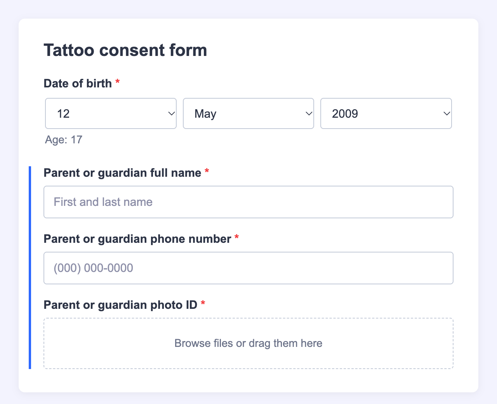

# Jotform Age Check Widget

A date-of-birth field for [Jotform](https://www.jotform.com) forms that calculates the person's exact age on the day they submit, and sorts them into an age group. Your form's conditions use the group to show different questions, for example parent or guardian details for 16–17-year-olds, or a "sorry, you're too young" message for anyone younger.

You host it yourself, for free, on Cloudflare. Everything runs in the visitor's browser; there's no API key, database or monthly bill.



## Contents

- [What it does](#what-it-does)
- [Why not Jotform's Form Calculation?](#why-not-jotforms-form-calculation)
- [What you need](#what-you-need)
- [Set it up with an AI assistant](#set-it-up-with-an-ai-assistant)
- [Setup, step by step](#setup-step-by-step)
- [Show different questions by age](#show-different-questions-by-age)
- [Your own age groups](#your-own-age-groups)
- [Customise the look and wording](#customise-the-look-and-wording)
- [What gets saved](#what-gets-saved)
- [Troubleshooting](#troubleshooting)
- [Updating your widget later](#updating-your-widget-later)
- [Security and privacy](#security-and-privacy)
- [For developers](#for-developers)

## What it does

- **Day, month and year dropdowns.** Month names are written out (no mixing up 05/12 and 12/05), the day list matches the month (no 30 February), and phones show their own scroll wheels.
- **Exact age on the day of submission.** It compares years, months and days like a person would, so someone turns 18 on their 18th birthday, not a day early or late. The age is checked again at the moment the form is sent.
- **Three age groups for your form's conditions:**

  | Age | Group (default name) |
  | --- | --- |
  | 18 and over | `GROUP_A` |
  | 16–17 | `GROUP_B` |
  | under 16 | `GROUP_C` |

  The ages (16 and 18) and the group names can be changed in the widget settings, for example to `ADULT`, `GUARDIAN` and `TOO_YOUNG`. Need a different number of groups? See [Your own age groups](#your-own-age-groups).
- **Updates as they type.** The form's conditions react as soon as a full date is chosen, before the form is sent.
- **Saves the date and the age together.** Each submission stores one line like `DOB: 2009-05-12 | Age: 17 | Group: GROUP_B`.
- **Matches your form.** Colours, font, sizes, wording, month language and date order (Day/Month/Year or Month/Day/Year) are set in Jotform, with no code changes.

## Why not Jotform's Form Calculation?

Jotform has no built-in age field. The usual workaround subtracts two dates in a Form Calculation widget and divides the number of days by 365.25. That's approximate and can be off by a day around someone's birthday, which matters when the rule is "18 or older". This widget works it out exactly, and a person born on 29 February has their birthday on 1 March in non-leap years.

## What you need

| | What for | Cost |
| --- | --- | --- |
| A **Jotform** account | Where your forms live | Free plan works |
| A **Cloudflare** account | Hosts the widget | Free plan works |
| A **domain on Cloudflare** (for example `example.com`) | Gives the widget an address like `age.example.com`. No domain? See the note in [step 3](#3-tell-the-project-your-address). | You may already have one |
| A computer with **Node.js 22.18 or newer** | To upload the widget to Cloudflare | Free, from [nodejs.org](https://nodejs.org) (choose the LTS version) |

Plan for about 20 minutes the first time. You'll type a few commands into a **terminal**: on a Mac open the **Terminal** app; on Windows open **PowerShell**. Type or paste each command, then press Enter.

## Set it up with an AI assistant

If you use an AI coding assistant that can run commands on your computer (Claude Code, Cursor, GitHub Copilot in agent mode, or similar), you can let it do the technical parts. Copy this prompt into it:

```text
Help me set up my own copy of the Jotform Age Check widget from
https://github.com/ar-va/jotform-age-check
by following its README. You can run commands on my computer; I'll do the
steps that need a browser or one of my accounts.

1. Check that Node.js 22.18 or newer is installed (if not, tell me how to
   install it). Get the project (git clone it, or tell me to download the ZIP),
   then run "npm install" and "npm install --global cf" in the project folder.
2. Run "cf auth login" and wait while I sign in to Cloudflare in my browser.
3. Ask me which address the widget should use: a subdomain of a domain in my
   Cloudflare account (for example age.example.com), or "workers.dev" if I
   don't have a domain. Create .env from .env.example with WIDGET_DOMAIN set to it.
4. Run "npm test", then deploy with "cf deploy". If it fails, use the README's
   Troubleshooting section to fix it.
5. Check it works: a plain request to https://<my address>/ should get 403,
   and the same request with the header "Sec-Fetch-Dest: iframe" should get 200.
6. Walk me through README steps 5 and 6 (creating the iFrame Widget in Jotform
   with my address as its URL, and adding it to a form), then the section
   "Show different questions by age". Ask which ages and which optional
   settings I want (date order, language, colours) and tell me exactly what to enter.

Never commit or share .env. Ask me before changing anything in my Cloudflare
account other than the deploy itself.
```

It will still need you for the parts only you can do: signing in and clicking through Jotform. The steps below explain each of them if you'd rather do it yourself.

## Setup, step by step

### 1. Download the project

Easiest: on this page click the green **Code** button → **Download ZIP**, then unzip it somewhere you'll find it again, such as your Documents folder.

(If you use Git: `git clone https://github.com/ar-va/jotform-age-check.git`)

### 2. Install the tools

In the terminal, go into the project folder. Type `cd` followed by a space, drag the unzipped folder onto the terminal window, and press Enter. Then run:

```sh
npm install
npm install --global cf
cf auth login
```

- `npm install` downloads what the project needs. Warnings are normal.
- `npm install --global cf` installs Cloudflare's command-line tool, `cf`.
- `cf auth login` opens your browser so you can sign in to Cloudflare and allow access.

### 3. Tell the project your address

Choose the address your widget will live at, on a domain in your Cloudflare account, for example `age.example.com`. Cloudflare creates it for you on the first upload; you don't need to set up DNS.

In the project folder there's a file called `.env.example`. Make a copy of it called `.env`:

```sh
cp .env.example .env        # Mac
copy .env.example .env      # Windows
```

Open `.env` in a text editor (TextEdit, Notepad, VS Code) and put your address after the `=` sign:

```text
WIDGET_DOMAIN=age.example.com
```

Files starting with a dot are hidden on Mac; in Finder press **Cmd + Shift + .** to show them. This file stays on your computer, so your address isn't stored in the project's code.

> **No domain?** Use a free `workers.dev` address instead: write `WIDGET_DOMAIN=workers.dev`, and in the Cloudflare dashboard open **Workers & Pages** and pick your `workers.dev` subdomain if asked. Your widget address is shown after the upload in step 4.

**Only if your forms use your own domain** (a Jotform custom domain such as `forms.example.com`, instead of `form.jotform.com`): open `src/index.ts` and add it to the `ALLOWED_HOSTS` list near the top, like `["jotform.com", "example.com"]`. Otherwise leave that file alone.

### 4. Upload the widget to Cloudflare

```sh
cf deploy
```

When you see **Deploy complete**, your widget is live.

**Check it:** open your widget address (for example `https://age.example.com`) in a browser. You should see **Forbidden**. That's correct: the widget only works inside a Jotform form. A brand-new address can take a few minutes to start working.

### 5. Create the widget in Jotform

1. Go to [jotform.com/widgets](https://www.jotform.com/widgets/), scroll down to **My Form Widgets** and click it.
2. At the bottom right, click **Add New Widget**.
3. Fill in the form:

| Field | What to enter |
| --- | --- |
| **Widget Icon** | Optional. Upload [`docs/icon-80.png`](docs/icon-80.png) (80×80). |
| **Widget Demo Screenshots** | Optional. You can use [`docs/screenshot.png`](docs/screenshot.png). |
| **Name** | Anything you'll recognise, e.g. `Age Check` |
| **Short Description**, **Description** | Optional, for your own reference |
| **Demo URL**, **Video URL** | Leave empty |
| **Categories** | Any that fits |
| **Widget Type** | **iFrame Widget**. In the URL field that comes with it, enter your widget address, e.g. `https://age.example.com/` |
| **Static Widget** | **Leave unticked.** Ticked, the widget wouldn't save the date to the form. |
| **Accessible Widget (A11Y)** | Optional |
| **Multiple Instance** | Leave unticked (one date of birth per form) |
| **Required By Default** | Optional; you can change it on each form anyway |
| **Default Label** | The question shown above the widget, e.g. `Date of birth` |
| **Question Label** | Tick it to show that label on the form |
| **User Parameters** | Optional settings you can change per form (ages, date order, language, colours). Click **Add Parameter** for each one; see [Customise the look and wording](#customise-the-look-and-wording). You can add them later. |
| **Under Review** | **Leave ticked** to keep the widget private: only you (and Jotform's admins) can see and use it |
| **Disabled** | Leave unticked |

4. Click **Add**.

### 6. Add it to a form

In the form builder, add your widget like any other field, label it "Date of birth" and make it **Required**. Then set up the conditions below.

## Show different questions by age

1. Add the fields each group needs. For example, for 16–17-year-olds: **Parent or guardian full name**, **phone number** and **photo ID** (File Upload), all marked **Required**. For under-16s: a **Paragraph** such as "Sorry, you must be at least 16 to continue." Jotform doesn't check Required on hidden fields, so marking them Required is safe.
2. Open **Settings → Conditions → Show/Hide Field** and add one condition per group:

| IF | STATE | TARGET | VALUE | DO | FIELD |
| --- | --- | --- | --- | --- | --- |
| Date of birth | Contains | Value | `GROUP_A` | Show | your adult-only fields |
| Date of birth | Contains | Value | `GROUP_B` | Show Multiple | guardian name, phone and photo ID |
| Date of birth | Contains | Value | `GROUP_C` | Show | the "too young" message |
| Date of birth | Contains | Value | `GROUP_C` | Hide | Submit |

Type the value exactly as the group name, without quotes. If you renamed the groups (see [Customise](#customise-the-look-and-wording)), use your names. Use the **+** next to **DO** to add the second action (Hide → Submit) to the same condition. Fields that a **Show** condition targets stay hidden until it matches.

- **No "Contains" for the widget?** Use **Ends With**: the group is always the last part of the saved value.
- **Questions for both adults and 16–17-year-olds?** Leave them always visible, or use one condition that matches **any** of `GROUP_A` or `GROUP_B`.

3. **Test in Preview** with dates exactly 18 years ago today, 18 years ago tomorrow, exactly 16 years ago, someone aged 15, and a 29 February birthday.

## Your own age groups

Need more (or fewer) than three groups, or different ages? Add the `ageGroups` setting (Field Type **Textarea**, see [Customise](#customise-the-look-and-wording)) and write one group per line, as **name = ages**:

```text
ADULT = 18+
GUARDIAN = 16-17
TOO_YOUNG = 0-15
```

- **Ages:** `18+` (18 and over), `16-17` (16 to 17, both included) or a single age like `16`.
- **Names:** letters, numbers, `_` and `-`, 2–30 characters, with at least one letter. Use the same names in your conditions.
- **As many groups as you need**, up to 20 lines. The same name can be used on more than one line, for example `DISCOUNT = 0-12` and `DISCOUNT = 65+`.
- **Ages that no line covers** are saved as `NO_GROUP`, so you can use that in a condition too.
- `:` works instead of `=`. If Jotform puts everything on one line, separate the groups with `;`.

When `ageGroups` is filled in, it replaces `minAge`, `adultAge`, `groupAbove`, `groupBetween` and `groupBelow`.

**If something in it is wrong, the widget ignores the whole setting** and uses those simpler settings (or `GROUP_A`, `GROUP_B`, `GROUP_C`) instead, rather than guessing. It's ignored when:

- a line can't be read (for example a space in a name, or a missing `=`)
- two ranges overlap (`ADULT = 18+` and `OLDER = 30+`)
- a range is backwards (`17-13`)
- one name is part of another (`TEEN` and `TEENS`), or of the words `DOB`, `Age`, `Group` or `NO_GROUP`. Otherwise "Contains" would match the wrong people.

After changing it, send a test submission and check the saved group. The browser console (right-click → Inspect → Console) shows the reason when the setting is ignored.

## Customise the look and wording

Each setting below is a **User Parameter** you add to your widget in Jotform (**My Form Widgets** → your widget → **Add Parameter**, see step 5). Once added, you change its value per form in the widget's **Settings → General** tab. Every one is optional: anything you don't add, or leave empty, keeps the default.

When adding a parameter, fill in:

- **Name:** exactly as in the table. Capital letters matter.
- **Human Readable Name:** any label you like; it's what you'll see in the settings panel.
- **Field Type:** as in the table.
- **Default Value:** see the table. Leave **Conditional Rendering** empty.

| Name | What it changes | Field Type | Default Value |
| --- | --- | --- | --- |
| `minAge` | Youngest age of the middle group (`GROUP_B` from this age) | Text | `16` |
| `adultAge` | Age from which someone is in the oldest group (`GROUP_A`) | Text | `18` |
| `groupAbove` `groupBetween` `groupBelow` | Names saved for the oldest, middle and youngest group, e.g. `ADULT`, `GUARDIAN`, `TOO_YOUNG`. Use letters, numbers, `_` and `-` (2–30 characters, at least one letter). A name can't be part of another name (`TEEN` and `TEENS`) or of the words `DOB`, `Age`, `Group`, otherwise "Contains" would match the wrong people; in that case the widget uses `GROUP_A`, `GROUP_B`, `GROUP_C` instead. | Text | leave empty |
| `ageGroups` | Any number of groups with their own ages and names, one per line, e.g. `ADULT = 18+`. Replaces the five settings above. See [Your own age groups](#your-own-age-groups). | Textarea | leave empty |
| `dateOrder` | Order of the dropdowns: `DMY` (day, month, year), `MDY` (month first, as in the US) or `YMD` | Dropdown (options `DMY`, `MDY`, `YMD`) | `DMY` |
| `language` | Language of the month names, as a code: `fr`, `es`, `de`, `en-CA` … | Text | leave empty (English) |
| `labelDay` `labelMonth` `labelYear` | The dropdowns' empty-state text, e.g. `Jour` | Text | leave empty |
| `ageText` | The line under the dropdowns; `{age}` becomes the age, e.g. `Âge : {age}` | Text | `Age: {age}` |
| `showAge` | `No` hides the age line | Dropdown (options `Yes`, `No`) | `Yes` |
| `futureDateText` | Message for a date in the future | Text | leave empty |
| `incompleteText` | Message when the date is only partly chosen | Text | leave empty |
| `accentColor` | Highlight around the active dropdown | Color | `#2e69ff` |
| `textColor` | Text in the dropdowns | Color | `#2c3345` |
| `labelColor` | The age line | Color | `#6c7389` |
| `borderColor` | Dropdown borders | Color | `#c3cad8` |
| `fieldBackground` | Inside of the dropdowns | Color | `#ffffff` |
| `errorColor` | Error messages and borders | Color | `#c6252b` |
| `fontFamily` | Font, e.g. `Inter, sans-serif` | Text | leave empty |
| `fontSize` | Text size in pixels, e.g. `15` | Text | leave empty |
| `fieldHeight` | Dropdown height in pixels, e.g. `40` | Text | leave empty |
| `cornerRadius` | Corner rounding in pixels, e.g. `4` | Text | leave empty |
| `customCSS` | Anything else, as CSS, e.g. `.age { font-weight: 600 }` | Textarea | leave empty |

Tips:

- **Settings say "undefined"?** Jotform only applies Default Values when the widget is added to a form. Delete the widget from the form and add it again. Do this before you collect real submissions. Invalid values (such as a colour that isn't one) are ignored, so the widget keeps working.
- **Matching your form's colours:** the widget can't read your form's theme by itself, so copy the colours from your form's **Form Designer** into the colour settings.

## What gets saved

Each submission has one column for the widget, holding the date of birth (always year-month-day), the age on the day it was sent, and the group:

`DOB: 2009-05-12 | Age: 17 | Group: GROUP_B`

To get the date and age in separate columns, split them after exporting:

- **Excel:** select the column → **Data → Text to Columns** → **Delimited** → **Other:** `|`.
- **Google Sheets:** `=REGEXEXTRACT(B2, "\d{4}-\d{2}-\d{2}")` for the date and `=VALUE(REGEXEXTRACT(B2, "Age: (\d+)"))` for the age (replace `B2` with the cell). If Jotform sends submissions straight to a sheet, put these formulas on a separate tab so new columns Jotform adds don't overwrite them.

**Editing a submission** reopens the widget with the saved date filled in. The age is worked out again from the date at that moment.

## Troubleshooting

**Opening the widget address shows "Forbidden".**
That's normal. The widget only loads inside a Jotform form. Test it through your form's preview.

**The widget doesn't appear in the condition's IF list.**
It has to be on the form first (step 6), and the form saved.

**The conditions don't react.**
Check the value is typed exactly like the group name (`GROUP_A`, `GROUP_B`, `GROUP_C`, or your own names), with no quotes. Send a test submission and look at the saved value: if a custom name you set isn't accepted, the widget saves the default name instead. If **Contains** doesn't work, try **Ends With**.

**The upload (`cf deploy`) fails.**
Read the message:

- "WIDGET_DOMAIN is not set": create the `.env` file from step 3.
- "workers.dev subdomain": set your own domain in `.env` (step 3), or pick a `workers.dev` subdomain in the Cloudflare dashboard.
- Anything about the domain: check it's spelled correctly and that the domain is in your Cloudflare account.
- Not signed in: run `cf auth login` again.

**The widget looks cut off or too tall in the form.**
It resizes itself. If it doesn't, check that the widget's URL in Jotform is exactly your widget address.

## Updating your widget later

After changing any file (including downloading a newer version of this project), upload again from the project folder:

```sh
cf deploy
```

<details>
<summary><strong>Optional: deploy automatically from your own GitHub copy</strong></summary>

If you keep your copy of the project on GitHub, Cloudflare can redeploy whenever you push changes:

1. Cloudflare dashboard → **Workers & Pages** → your widget → **Settings → Builds → Connect**.
2. Choose GitHub and give access to **only that repository**.
3. Branch `main`, **Build command** empty, **Deploy command** `npx cf deploy`, **Preview builds** off.
4. Under **Build variables**, add `WIDGET_DOMAIN` with your widget address (the same value as in your `.env`). Mark it as a secret if you'd rather not show it in the dashboard.

</details>

## Security and privacy

- **The age is worked out in the visitor's browser**, from their device's date. Nothing is sent anywhere except to your form. Someone who sets their device clock wrong, or simply enters a false date, gets a wrong age: **always check photo ID in person** where the law requires it.
- **The widget only runs inside Jotform forms.** Opening it directly, or embedding it on another website, is blocked.
- **Only valid dates are saved.** The dropdowns allow real dates from the last 110 years; dates in the future are rejected.

<details>
<summary><strong>Details for technical readers</strong></summary>

- **Widget page:** served only for `Sec-Fetch-Dest: iframe` (with a `jotform.com` Referer fallback for older browsers) and a CSP `frame-ancestors` restricted to `jotform.com`. Direct visits get 403; only GET/HEAD is allowed (405 otherwise); other paths get 404. It also sends `nosniff`, `Referrer-Policy: same-origin`, a Permissions-Policy, and a CSP blocking plugins, `<base>` and form posts. Script sources aren't restricted, because Jotform's widget library loads its own theme scripts and fonts at runtime.
- **`/age.js`** is served without the iframe check (it has no secrets) and with `nosniff`.
- **Output:** all text is inserted with `textContent`, never as HTML. The saved value starts with `DOB:`, so it can't be read as a spreadsheet formula.
- **Validation:** an empty widget is valid (Jotform's Required setting decides whether an answer is needed); a partly chosen or future date is invalid and blocks submission with a message.

</details>

## For developers

<details>
<summary><strong>How it works, project layout and tests</strong></summary>

```text
Jotform form ──iframe──▶ your-domain/        widget page (public/index.html)
                              └─ script ──▶ /age.js   age logic (public/age.js)
                         Cloudflare Worker (src/index.ts) gates and serves both
```

| File | What it is |
| --- | --- |
| `public/index.html` | The widget page: dropdowns, Jotform API wiring, parameters. No build step |
| `public/age.js` | Pure date and age logic (sets `window.AgeCalc`) |
| `src/index.ts` | The Cloudflare Worker: iframe gating and security headers |
| `cloudflare.config.ts` | Worker name and assets; reads your address from `WIDGET_DOMAIN` |
| `tests/age.test.js` | Unit tests for `age.js` (Node's built-in test runner) |

The widget uses Jotform's Custom Widget API: `subscribe("ready")` (settings, restoring a saved value), `sendData` on every change (so conditions react live), `subscribe("submit")` with `sendSubmit({ valid, value })`, and `requestFrameResize`.

Commands:

```sh
npm test               # unit tests
npx tsc --noEmit       # type-check the Worker
cf dev                 # local server (the page still needs Sec-Fetch-Dest: iframe)
```

To try the widget on its own, open `public/index.html` straight from disk in a browser. Outside Jotform it shows the value it would save, and takes settings from the URL, e.g. `index.html?dateOrder=MDY&language=fr`.

</details>

## Support

If this widget saved you time, you can buy me a coffee:

[](https://ko-fi.com/U7P1293ZXN)

## License

[MIT](LICENSE): free to use, change and share.
